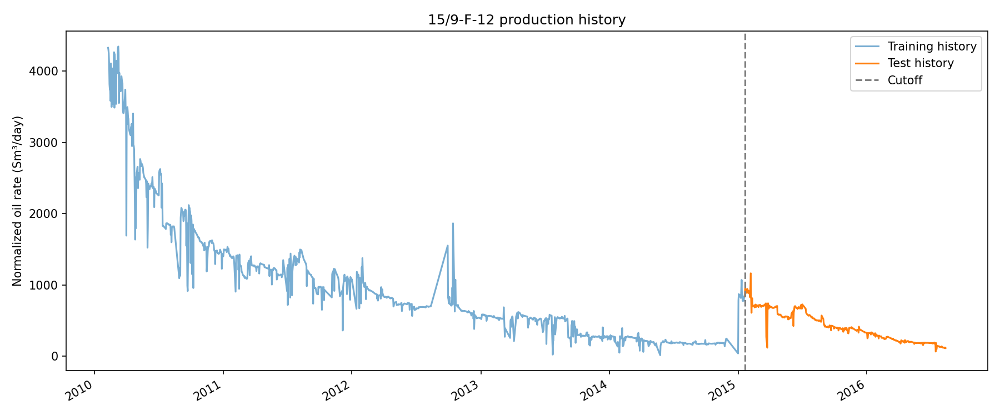
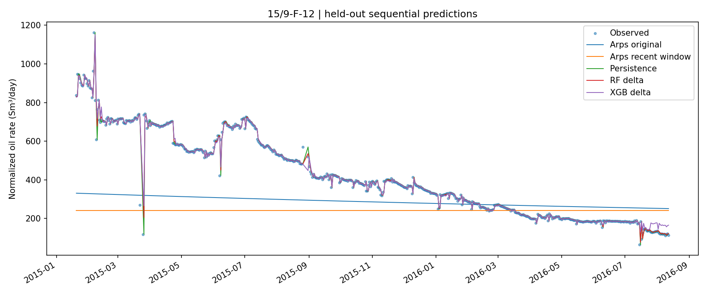
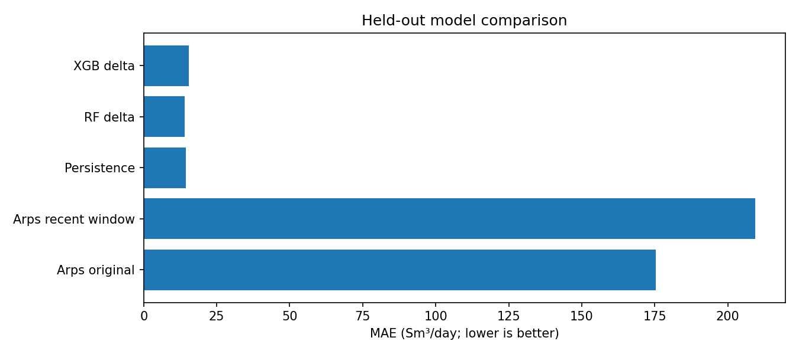
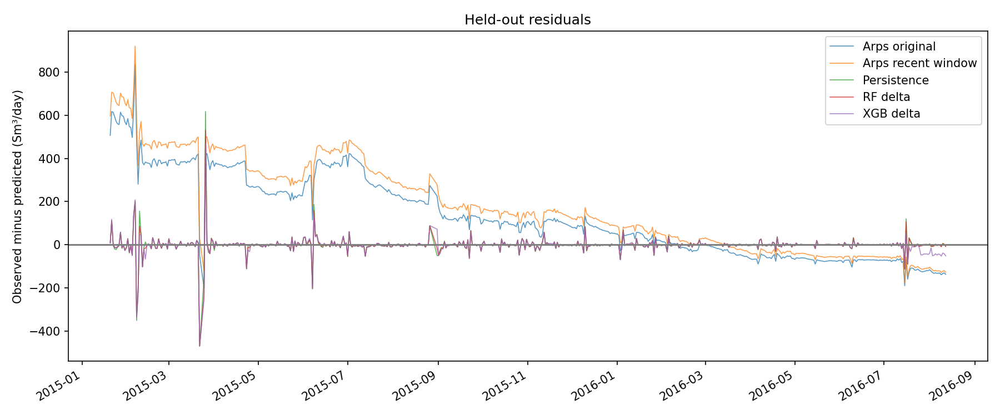

# Oil Well Production Forecasting Using Decline Curve Analysis and Machine Learning

`Petroleum Engineering` · `Production Analytics` · `Machine Learning` · `Python`

## Overview

This project compares conventional decline curve analysis and machine learning for oil well production prediction using historical field measurements from Equinor's Volve field in the Norwegian North Sea. The case study focuses on well **15/9-F-12**.

The workflow investigates whether learning changes in production rate, rather than predicting absolute rates directly, improves short-term predictions under changing production conditions.

## Dataset

- Source: [Equinor — Volve data sharing](https://www.equinor.com/energy/volve-data-sharing)
- Workbook: `Volve production data.xlsx`
- Worksheet: `Daily Production Data`
- Inputs: production date (`DATEPRD`), well identifier (`NPD_WELL_BORE_NAME`), oil volume (`BORE_OIL_VOL`) and flowing hours (`ON_STREAM_HRS`).
- Case study: 1,562 training observations and 565 test observations after preprocessing and feature construction.
- Chronological cutoff: 20 January 2015.

The raw workbook, row-level predictions and serialized models are not distributed here. Obtain the data from its provider and observe the applicable data terms. The figures and aggregate metrics below were generated during the local run; confirm the provider's terms before public redistribution of derived results.

## Production history



## Methodology

1. Filter invalid measurements, non-positive oil volumes and records with fewer than two flowing hours; sort by date.
2. Normalize oil volume to a 24-hour flowing-rate equivalent: `q = 24 × oil volume / flowing hours` (Sm³/day).
3. Determine a decline-start point using training history only and separate training and testing observations chronologically.
4. Fit the Arps hyperbolic decline equation using nonlinear least squares. Compare a full training window with a recent window selected through chronological validation.
5. Train Random Forest and XGBoost regressors to estimate the change from the previous observed production rate.
6. Compare sequential predictions against a persistence baseline using R², RMSE and MAE.

### Arps decline curve

$$q(t)=\frac{q_i}{(1+bD_i t)^{1/b}}$$

Here, $q_i$ is the initial rate, $D_i$ is the initial nominal decline rate, and $b$ is the decline exponent. Time is measured in days.

### Machine learning approach

The baseline implementation predicts absolute production rates. The revised implementation predicts rate changes and combines them with the previous observed rate:

$$\hat{q}_t=\max(0,q_{t-1}+\alpha\widehat{\Delta q_t})$$

The correction weight $\alpha$ is selected on an internal chronological validation subset. The final models are then fitted on the full training partition.

| Feature group | Inputs |
|---|---|
| Lagged rates | Previous 1, 3, 7 and 14 observations |
| Rolling averages | Previous 3, 7 and 14 observations |
| Trends | Changes over recent 3 and 7 observations |
| Time gap | Days since the previous observation |

## Results

Results from the local Version 2 run on 565 held-out sequential observations:

| Model | R² | RMSE (Sm³/day) | MAE (Sm³/day) |
|---|---:|---:|---:|
| Arps — full window | -0.1937 | 229.61 | 175.28 |
| Arps — recent window | -0.7162 | 275.31 | 209.38 |
| Persistence | 0.9538 | 45.16 | 14.47 |
| Random Forest — rate change | 0.9583 | 42.94 | **14.08** |
| XGBoost — rate change | **0.9587** | **42.68** | 15.44 |

### Observed versus predicted production



### Model comparison



### Residual analysis



### Key findings

- Rate-change modelling reduced Random Forest MAE from 71.71 to 14.08 Sm³/day and XGBoost MAE from 101.87 to 15.44 Sm³/day relative to the direct-rate baseline implementations.
- Random Forest achieved the lowest MAE, approximately 2.7% below persistence. XGBoost achieved the highest R² and lowest RMSE, but did not beat persistence on MAE.
- The production history shows a marked rate increase around January 2015, indicating a change in production behaviour. Its operational cause is not established by these data.
- The recent-window Arps fit selected 365 observations but reached a nearly zero decline rate and performed worse than the full-window fit. This highlights the limitations of fitting a single decline regime across changing operating conditions.

## Repository structure

```text
.
├── src/
│   ├── forecast.py          # Original adapted direct-rate workflow and shared functions
│   └── forecast_v2.py       # Rate-change prediction and validation
├── tests/                   # Basic engineering checks
├── results/                 # Saved figures, aggregate metrics and run configuration
├── requirements.txt
├── .gitignore
└── README.md
```

## Run locally

Python 3.10 is recommended. From the repository root in Windows Anaconda Prompt:

```bat
conda create -n production-ml python=3.10 -y
conda activate production-ml
python -m pip install -r requirements.txt
```

Create `data/raw/` and place the Volve workbook there. Run:

```bat
python src/forecast_v2.py
```

Alternatively, supply the workbook explicitly:

```bat
python src/forecast_v2.py --data "C:\path\to\Volve production data.xlsx"
```

The default well is `15/9-F-12`. To specify another well, use `--well` with its exact workbook identifier. Results may differ by well and dependency versions.

To reproduce the earlier direct-rate baseline:

```bat
python src/forecast.py
```

The revised script writes figures, metrics, row-level predictions, run configuration and model artifacts to `outputs_v2/`. The earlier script writes to `outputs/`.

